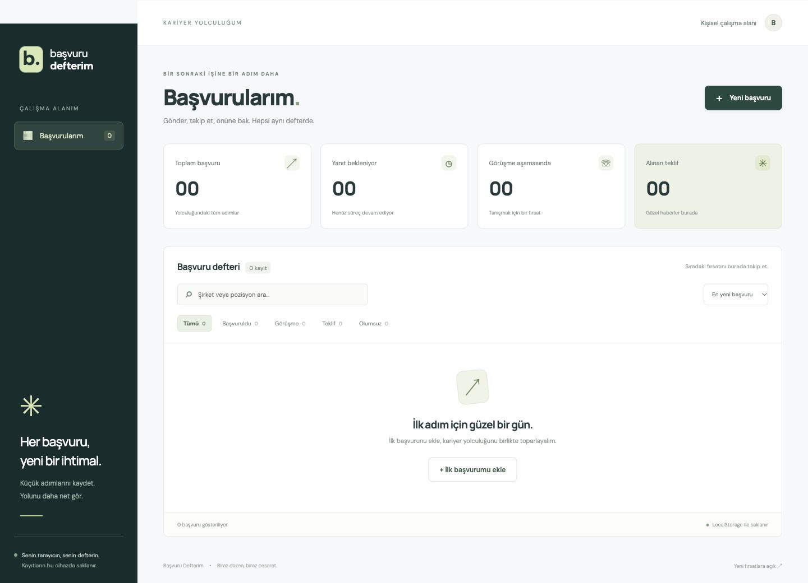

# Web Geliştirme - Javascript Projesi

Bu projede iş ve staj başvurularını takip etmek için bir uygulama hazırladım. Adı **Başvuru Defterim**. Başvurduğum şirketleri ve sürecin hangi aşamada olduğunu tek yerde görebileyim diye bu konuyu seçtim.

## Uygulamada neler var?

- Şirket ve pozisyon bilgileriyle başvuru ekleme
- Başvuruları listeleme, düzenleme ve silme
- Başvuruya tarih, durum ve not ekleme
- Şirket veya pozisyona göre arama
- Duruma göre filtreleme ve başvuruları sıralama
- Toplam başvuru, görüşme ve teklif sayılarını görme

React, Vite ve sade CSS kullandım. Kayıtlar LocalStorage'da tutuluyor. Yani sayfayı yenileyince kayıtlar duruyor ama başka bir tarayıcıdan açınca aynı kayıtlar gelmiyor. Tarayıcı verileri temizlenirse kayıtlar da siliniyor.

## Nasıl çalıştırılır?

Bilgisayarda Node.js kurulu olması gerekiyor. Benim ayarladığım sürüm 22.14.0.

Proje klasöründe terminal açıp:

```bash
npm install
npm run dev
```

Sonra terminalde çıkan yerel adresi tarayıcıda açmak yeterli.

## Test etmek için

```bash
npm test
```

## Netlify'a yüklemek için

```bash
npm run build
```

Bu komut `dist` klasörünü oluşturuyor. Netlify'a bu klasör yüklenebilir. GitHub üzerinden bağlanırsa build komutu `npm run build`, yayın klasörü `dist` olacak. Ayarları `netlify.toml` dosyasına da ekledim.

## Ekran görüntüsü


